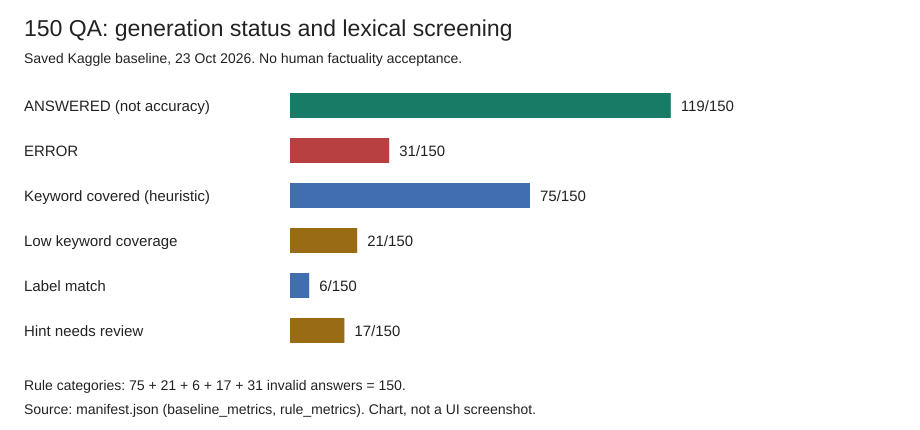

# Báo cáo tuần 04

**Đề tài:** Xây dựng hệ thống quản lý học tập thông minh tích hợp mô hình ngôn ngữ lớn tinh chỉnh và kỹ thuật RAG.  
**Thành viên:** Vũ Nam Dương (A, B22DCVT119) và Trần Tuấn Cường (B, B22DCVT073).  

## 1. Mục tiêu trong tuần

Hoàn thiện chức năng học tập, đưa trợ lý AI vào LMS và thiết lập baseline trước khi tinh chỉnh mô hình:

- **LLM và dữ liệu:** Qwen NF4 trên Kaggle, checkpoint tái sử dụng và bộ đánh giá 150 QA.
- **RAG và chatbot:** trả lời/gợi ý theo học liệu có quyền, kiểm ngân sách token/citation và mở PDF đối chiếu.
- **Học tập tương tác:** video có câu hỏi theo mốc; bài tập/kiểm tra, chấm điểm và thống kê theo vai trò.
- **Thông báo:** lịch sử, trạng thái đọc và cập nhật thời gian thực.
- **Đánh giá:** đo lỗi/độ trễ, chấm sơ bộ bằng quy tắc và lưu minh chứng để review.

## 2. Công việc đã thực hiện

### 2.1. Chuẩn bị LLM và dữ liệu thử nghiệm

**A phụ trách.** Xây dựng Provider cho Qwen2.5-7B-Instruct NF4 4-bit trên Kaggle T4, cố định revision, xuất và kiểm chứng nạp lại checkpoint. Mở rộng 100 QA thành 150 QA thuộc ba môn, chuẩn hóa ID, giữ đáp án chuẩn ngoài prompt. Smoke test năm ca QA/gợi ý/thiếu căn cứ giúp phát hiện lỗi ngôn ngữ, citation và lộ đáp án; không thay nghiệm thu chất lượng.

Minh chứng: [notebook](../../notebooks/generation_setup.ipynb), [Provider](../../backend/apps/ai/providers/local.py), [100 QA baseline](../../data/qa/qa_baseline.json), [50 QA bổ sung](../../data/qa/qa_additions.json), [mapping ID](../../data/qa/qa_id_mapping.csv).

### 2.2. Xây dựng luồng sinh đáp án

**A phụ trách, phối hợp B tích hợp.** Pipeline nhận câu hỏi, chế độ QA/gợi ý và nguồn có document/version/chunk/page. Tokenizer thật đo prompt; chunk không vừa ngân sách bị bỏ nguyên đoạn, có truy vết. QA dùng nội dung model sinh; gợi ý giới hạn model chọn thao tác đọc/dàn ý/so sánh rồi dựng lời hướng dẫn từ mẫu. Kiểm model/revision, usage, kết thúc sinh và citation thuộc nguồn thực sự trong prompt; chặn đầu ra không hợp lệ.

Minh chứng: [pipeline](../../backend/apps/ai/rag/pipeline.py), [context builder](../../backend/apps/ai/rag/context_builder.py), [citation](../../backend/apps/ai/rag/citations.py), [guardrail](../../backend/apps/ai/rag/guardrails.py).

### 2.3. Chạy và đánh giá 150 QA trên Kaggle

**A phụ trách.** Tái sử dụng FAISS, truy xuất top 5 chunk theo môn, dựng prompt rồi gọi Qwen; giữ mọi lỗi, không retry/repair. Profile `frozen_baseline`: context/input/output tối đa **4096/3584/256 token**, timeout sinh mềm **30 giây**. Đây là tập phát triển trước QLoRA, không phải held-out test độc lập.

| Chỉ số | Kết quả |
| --- | --- |
| ANSWERED | **119/150 (79,33%)**, không phải độ chính xác kiến thức |
| Lỗi | **31/150**: 15 timeout, 6 hết output, 10 đầu ra không hợp lệ |
| Latency trung bình / p95 | **17,57 / 30,44 giây**, gồm retrieval và pipeline, có các ca lỗi |
| Retrieval | 150 lượt OK; trung bình **0,310 giây** |
| Page Recall@1 / @3 / @5 | **75% / 95% / 97%** |

Bộ chấm quy tắc đọc predictions đã lưu, không gọi model: **75** câu đạt ngưỡng từ khóa, **21** thiếu từ khóa, **6** khớp nhãn, **17** gợi ý cần review và **31** không có đáp án hợp lệ. Trong 119 câu ANSWERED, 106 câu trích trang gold; khớp trang/từ khóa không tự chứng minh phát biểu đúng hoặc nguồn hỗ trợ đầy đủ.

Minh chứng: [metrics.csv](metrics.csv), [manifest.json](manifest.json), [runner](../../scripts/run_rag_evaluation.py), [bộ chấm](../../backend/apps/ai/evaluation/factuality.py).

### 2.4. Hoàn thiện video tương tác

**B phụ trách.** Giáo viên tải/công bố video, tạo câu hỏi trắc nghiệm một/nhiều đáp án hoặc tự luận theo mốc, đặt đoạn xem lại và xem câu trả lời. Học viên được dừng tại câu hỏi; backend lưu tiến độ, kiểm revision/request ID và không cho tua/tải lại tự vượt câu hỏi. Video hoàn thành cho phép xem lại, tra lịch sử; tự luận không tự kết luận đúng/sai.

Ảnh giáo viên: [thêm video](figures/teacher-video-upload.png), [không gian video](figures/teacher-video-workspace.png), [câu trắc nghiệm](figures/teacher-video-quiz-question.png), [câu tự luận](figures/teacher-video-written-question.png), [quản lý câu hỏi](figures/teacher-video-question-list.png), [câu trả lời học viên](figures/teacher-video-student-responses.png).  
Ảnh học viên: [câu hỏi tại mốc](figures/student-video-checkpoint-question.jpg), [xem video/lịch sử](figures/student-video-player.png).

### 2.5. Bài tập, kiểm tra và thống kê

**B phụ trách.** Bổ sung quiz, tự luận/nộp file; phân biệt PRACTICE/TEST, quản lý hạn/thời lượng, lưu và nộp lượt làm. Quiz tự chấm; giáo viên chấm tự luận thang 0–10, phản hồi và công bố điểm. Có dashboard, lọc trạng thái, lịch sử và xuất Excel. TEST yêu cầu toàn màn hình, ghi sự kiện và chặn AI; đây là hỗ trợ kiểm soát, không bảo đảm chống gian lận tuyệt đối.

Ảnh: [tạo quiz](figures/teacher-quiz-create.png), [tạo bài tự luận](figures/teacher-written-assignment-create.png), [dashboard](figures/teacher-assessment-results.png), [làm quiz](figures/student-quiz-attempt.png), [làm tự luận](figures/student-written-assignment.png).

### 2.6. Thông báo và cập nhật thời gian thực

**B phụ trách.** PostgreSQL lưu lịch sử; Redis hỗ trợ vé kết nối và WebSocket, không thay kho dữ liệu. Có số chưa đọc, lọc, đánh dấu đọc, phân trang và toast. WebSocket báo thay đổi để giao diện tải qua API; backend kiểm người nhận/quyền khi mở đích, giao diện tải bù khi kết nối lại.

Minh chứng: [giao diện thông báo](figures/notifications-panel.png), [tài liệu module](../../docs/notifications.md).

### 2.7. Tích hợp chatbot có citation

**B tích hợp; A cung cấp pipeline/model và vận hành endpoint.** PDF đi qua trích xuất → chunk → BGE-M3 CPU → snapshot FAISS; lập chỉ mục không tự công bố học liệu. API lấy danh tính từ JWT, kiểm quyền PostgreSQL trước truy xuất và sau generation, chỉ chuyển context/bài tập công khai. Chatbot có trạng thái chờ, citation kèm đoạn trích, mở PDF đúng phiên bản/trang và like/dislike theo chủ câu trả lời.

Profile online có hai replica, mỗi câu hỏi dùng một GPU: context/input/output **6144/3584/1024 token**, timeout **90 giây**, prompt `bounded_guidance`. Profile này **khác baseline 150 QA**, chưa chứng minh một câu hỏi nhanh gấp đôi. Báo cáo ghi nhận ca CPU có citation/PDF và chạy đồng thời; còn ca `INVALID_GENERATION`, lẫn ngôn ngữ. Chat chưa lưu bền vững hoặc đưa hội thoại nhiều lượt vào model.

Minh chứng: [câu trả lời](figures/chatbot-answer.png), [tooltip citation](figures/chatbot-citation-tooltip.png), [PDF nguồn](figures/chatbot-citation-pdf.png), [báo cáo tích hợp](../../docs/reports/w4-ab-generation-integration.md).

## 3. Quản lý mã nguồn và minh chứng

| Thành phần | Tham chiếu |
| --- | --- |
| PR của A / B | [PR #6](https://github.com/CuongTT-04/smart-lms-rag/pull/6) / [PR #5](https://github.com/CuongTT-04/smart-lms-rag/pull/5), theo báo cáo nhóm |
| Commit tiêu biểu | `0e08a08`: pipeline/đánh giá; `ce229dd`: video/bài tập/thông báo; `d79294d`: tích hợp chatbot |
| Milestone | Báo cáo ghi **RAG answer, citations**; review và tag cuối tuần cần đối chiếu GitHub |
| Chỉ số/cấu hình | [metrics.csv](metrics.csv), [manifest.json](manifest.json) |
| Test chạy lại 24/10/2026 | **202 test Python**, **328 test frontend / 51 file**, lint/build đạt; [log gộp](test-results.txt) |
| Ảnh giao diện | 17 ảnh gốc mục 2.4–2.7; nguồn/checksum trong manifest, không phải lượt test mới |

## 4. Tổng kết và hướng tiếp theo

Nhóm đã có LLM/pipeline RAG, baseline 150 QA, bộ chấm quy tắc và các chức năng LMS tích hợp. **Đã triển khai không đồng nghĩa đã nghiệm thu đầy đủ chất lượng, phân quyền và mọi tình huống online.**

- Chấm người cho factuality, grounding, citation và gợi ý; rà soát QA/gold trước fine-tune/QLoRA.
- Phân tích 31 lỗi baseline, cải thiện ngữ cảnh, tiếng Việt/định dạng và tốc độ; đánh giá lại với cấu hình rõ ràng.
- Nghiệm thu live: câu có căn cứ/ngoài nguồn, PRACTICE/TEST, thu hồi nguồn/quyền và mở PDF đúng trang.
- Thiết kế lịch sử chat bền vững có kiểm quyền; hoàn thành review chéo Issue/PR và chốt tag `w04` trên commit bàn giao.
