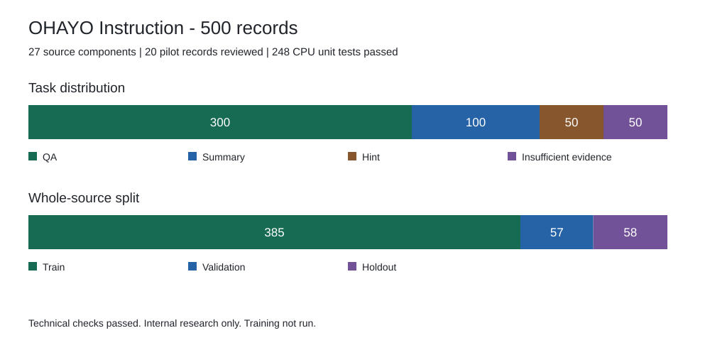
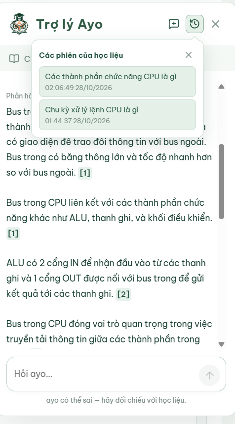

# Báo cáo tuần 05

**Đề tài:** Xây dựng hệ thống quản lý học tập thông minh tích hợp mô hình ngôn ngữ lớn tinh chỉnh và kỹ thuật RAG.
**Thành viên:** Vũ Nam Dương (A, B22DCVT119) và Trần Tuấn Cường (B, B22DCVT073).  

## 1. Mục tiêu trong tuần

Chuẩn bị **500 mẫu instruction** cho QLoRA, thống nhất định dạng, kiểm chất lượng và chia tập. Hoàn thiện lịch sử, context hội thoại và xử lý lỗi Ayo. **Chưa huấn luyện QLoRA trong tuần 05.**

## 2. Công việc đã thực hiện

### 2.1. Xây dựng công cụ chuẩn bị và kiểm định dữ liệu instruction phục vụ tinh chỉnh QLoRA

**Chốt quy cách đầu vào:** thống nhất trường dữ liệu và bốn tác vụ QA, tóm tắt, gợi ý, thiếu căn cứ; tách metadata/review khỏi prompt.

**Tạo mẫu kiểm thử và bộ kiểm tra:** sáu câu hỏi nền được biến đổi thành fixture đúng/sai để kiểm cấu trúc, nguồn/citation, hash, benchmark và xuất SFT. **6 file, 77 test CPU đạt.**

Minh chứng: [schema](../../data/instruction/record-schema.json), [fixture](../../scripts/instruction/tests/support.py), [bộ test](../../scripts/instruction/tests/), [log kiểm thử](test-results.txt).

### 2.2. Xây dựng mẫu

**Xây dựng mẫu kiểm thử:** 20 pilot gồm 12 QA, 4 tóm tắt, 2 gợi ý và 2 thiếu căn cứ; **20/20 đạt cho nghiên cứu nội bộ, 0 sửa/loại**. Kết quả không thay nghiệm thu cả bộ.

**Mở rộng mẫu, chia tập và xuất dữ liệu SFT:** **500 mẫu**, gồm 300 QA, 100 tóm tắt, 50 gợi ý, 50 thiếu căn cứ từ 27 PDF/ba môn. Chia nguyên nhóm nguồn: **385 train / 57 validation / 58 holdout**.

ZIP riêng tư có 6 file: ba tập SFT, metadata, cấu hình và manifest; đã kiểm nguồn/hash/token. Quyền nguồn chưa xác minh, không phát hành công khai.

Minh chứng: [dataset card v2.0](../../docs/dataset-card-v2.0.md), [metrics.csv](metrics.csv), [manifest.json](manifest.json).

### 2.3. Bổ sung thêm lịch sử và context hội thoại

Ayo lưu phiên/lượt trên PostgreSQL; có **Chat mới, Lịch sử và khôi phục phiên**. Kiểm quyền khi đọc; nguồn bị thu hồi, đổi phiên bản hoặc mất quyền thì phiên không còn khả dụng. TEST chặn trợ lý và lịch sử.

Context tối đa **4 cặp COMPLETED/768 token**; bỏ cặp cũ khi đầy, không dùng FAILED hoặc citation cũ. Chống gửi trùng, một lượt PENDING/phiên, lease 180 giây; không ghi đè kết quả muộn. Đồng bộ API/Kaggle và chuẩn hóa lỗi nguồn, citation, ngôn ngữ/định dạng, đáp án trống.

Minh chứng: [quản lý phiên](../../backend/apps/ai/conversations.py), [context](../../backend/apps/ai/rag/conversation.py). Ảnh nguyên bản mục 2.3:

## 3. Quản lý mã nguồn và bằng chứng

| Thành phần | Tham chiếu |
| --- | --- |
| Repository / PR | [smart-lms-rag](https://github.com/CuongTT-04/smart-lms-rag), [PR #10](https://github.com/CuongTT-04/smart-lms-rag/pull/10), [PR #11](https://github.com/CuongTT-04/smart-lms-rag/pull/11), theo báo cáo |
| Commit tiêu biểu | `ce431c5`: dữ liệu/công cụ; `14f081b`: SFT/dataset card; `5638609`: lịch sử/context; `283ffd8`: tích hợp/kiểm định |
| Milestone | Chuẩn bị instruction dataset cho QLoRA; kiểm tra chất lượng mẫu |
| Kết quả kiểm tra | **248 test CPU đạt**: 77 instruction, 46 kiểm định dữ liệu, 125 runtime; [log gộp](test-results.txt) kế thừa đợt tích hợp trước |
| Chỉ số và toàn vẹn | [metrics.csv](metrics.csv), [manifest.json](manifest.json); ảnh trong `figures/` |

Audit dữ liệu/ZIP đã kiểm lại; báo cáo ghi nhận smoke Qwen thật nhưng lần cập nhật minh chứng này không chạy lại model hoặc xác minh trạng thái GitHub.

## 4. Tổng kết và hướng tiếp theo

Nhóm đã hoàn thiện bộ công cụ, 20 mẫu pilot và gói SFT 500 mẫu; bổ sung lịch sử, context hội thoại và xử lý lỗi Ayo. **Đạt kiểm kỹ thuật không đồng nghĩa đã nghiệm thu toàn bộ nội dung hoặc chứng minh chất lượng sau fine-tune.** Chưa huấn luyện QLoRA; quyền nguồn chưa xác minh, chỉ sử dụng nội bộ.

- Hoàn thiện review nội dung theo ID/hash; sửa và audit lại khi dữ liệu thay đổi.
- Kiểm trainer/collator, token/EOS/loss mask; chạy thử QLoRA.
- Mở rộng nghiệm thu Ayo: câu hỏi nối tiếp, chuyển phiên, thu hồi nguồn/quyền và lỗi ngôn ngữ, citation, kết nối trên dịch vụ thật.
