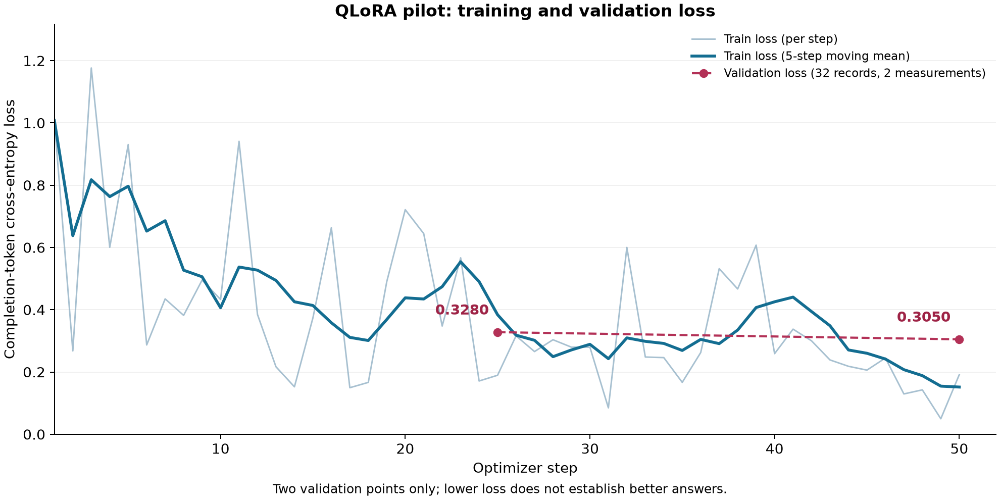
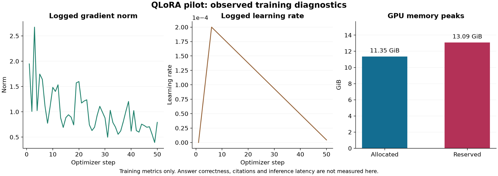

# Báo cáo tuần 06

**Đề tài:** Xây dựng hệ thống quản lý học tập thông minh tích hợp mô hình ngôn ngữ lớn tinh chỉnh và kỹ thuật RAG.  
**Thành viên:** Vũ Nam Dương (A, B22DCVT119) và Trần Tuấn Cường (B, B22DCVT073).

## 1. Mục tiêu trong tuần

Thử nghiệm QLoRA quy mô nhỏ: chuẩn bị môi trường, xây trainer/collator, huấn luyện và lưu adapter, checkpoint, cấu hình, log. Kiểm tra cập nhật tham số, nạp lại và tiếp tục huấn luyện; mở rộng bộ instruction lên **1.000 mẫu** để chuẩn bị đánh giá tiếp theo.

**Dương:** môi trường, trainer/collator, GPU smoke và pilot. **Cường:** chuẩn bị đầu vào, tiếp nhận kết quả và kiểm chứng GPU độc lập. Mỗi người bổ sung 250 mẫu mới.

## 2. Công việc đã thực hiện

### 2.1. Chuẩn bị môi trường training riêng

Ba cell đầu của `qlora_training.ipynb` tiếp nhận gói đầu vào, kiểm checksum, thiết lập môi trường riêng và kiểm khả năng chạy trên Tesla T4. **NF4 CUDA forward, FP16 và backward đều đạt**; kiểm đủ **128 train + 32 validation**, không dùng holdout để huấn luyện.

Trạng thái `ENVIRONMENT_READY_FOR_SMOKE` chỉ xác nhận môi trường: ở bước này chưa nạp trọng số Qwen, chưa có cập nhật tham số.

### 2.2. Xây trainer và collator

Trainer nạp Qwen đúng revision, giữ cố định base lượng tử hóa NF4 và chỉ học adapter LoRA. Cấu hình chính: **r = 8, alpha = 16, dropout = 0,05, all-linear, learning rate = 0,0002, batch = 1, tích lũy gradient = 4**, warmup 10%.

Collator giới hạn **2.048 token**, padding bên phải theo bội số 8; phân biệt PAD/EOS và gán nhãn `-100` cho prompt, padding để loss chỉ tính trên phần đáp án. `runtime.py` kết nối huấn luyện, validation, lưu và tiếp tục checkpoint.

### 2.3. Huấn luyện

**GPU smoke:** chạy 2 optimizer steps để kiểm cơ chế cập nhật thật trước pilot. **Pilot:** khởi tạo adapter mới, không tiếp tục từ smoke; huấn luyện **50 optimizer steps trên 128 train / 32 validation**, lưu checkpoint 25/50 và final adapter.

Audit xác nhận đủ cập nhật, loss/gradient hữu hạn, base giữ nguyên, adapter thay đổi, đủ state và checksum; final adapter khớp checkpoint 50. Đầu ra: `pilot-20261104T180615021055Z.zip`, `pilot-20261104T180615021055Z-audit.json` và `pilot-20261104T180615021055Z-receipt.json`.

| Chỉ số | Kết quả |
| --- | --- |
| Train loss trung bình 10 bước đầu / cuối | 0,60165 / 0,20599 |
| Validation loss bước 25 / 50 | 0,32795 / 0,30504; giảm khoảng 6,99% |
| VRAM cực đại allocated / reserved | 11,35 / 13,09 GiB |

Gradient dao động nhưng không có dấu hiệu bùng nổ kéo dài trên biểu đồ; learning rate tăng trong warmup rồi giảm. **Mô hình đã học thật và loss cải thiện**, nhưng hai mốc validation chưa đủ chứng minh không overfit, tổng quát hóa tốt hoặc trả lời tốt hơn base.

### 2.4. Mở rộng dữ liệu và kiểm bộ ứng viên 1.000 mẫu

Gộp **500 mẫu cũ + 250 mẫu mới của Dương + 250 mẫu mới của Cường**; chia thành **770 train / 114 validation / 116 holdout**, giữ các nhóm nguồn và biến thể cùng tập. Kiểm nguồn, trùng lặp, benchmark leakage, token/EOS/loss mask; độ dài lớn nhất **1.602 token**.

Bộ 1.000 mẫu là **ứng viên đã kiểm kỹ thuật**, còn cần thống nhất định dạng và review nội dung theo ID/hash trước khi chốt sử dụng. Pilot đã chạy vẫn dùng bộ 128/32, **không phải huấn luyện trên toàn bộ 1.000 mẫu**. Số liệu tổng hợp và thông tin xác định các gói dữ liệu nằm trong [metrics.csv](metrics.csv) và [manifest.json](manifest.json).

### 2.5. Tiếp nhận checkpoint, kiểm reload/resume và đối chiếu development

Kiểm receipt, manifest và checksum trước khi đọc checkpoint. Cường chạy kiểm chứng độc lập trên Kaggle: nạp lại adapter trong tiến trình mới; tiếp tục từ **checkpoint 25 đến bước 26**, giữ lịch huấn luyện 50 bước và thực hiện đúng một cập nhật.

Đợt `verification-20261106T194045367524Z` đạt reload/resume; đã kiểm **90 file**, xác nhận **392 tensor adapter thay đổi**, độ lệch L2 khoảng **0,14360**. Kết quả và checksum gói kiểm chứng được ghi trong [manifest.json](manifest.json).

Đối chiếu development gồm **20 ca × 2 nhánh = 40 đầu ra** hợp lệ để kiểm quy trình, chưa thay thế đánh giá chất lượng tổng thể. Adapter chưa được triển khai vào Ayo.

## 3. Quản lý mã nguồn và bằng chứng

| Thành phần | Tham chiếu |
| --- | --- |
| Repository / PR | [smart-lms-rag](https://github.com/CuongTT-04/smart-lms-rag), [PR #15](https://github.com/CuongTT-04/smart-lms-rag/pull/15), [PR #14](https://github.com/CuongTT-04/smart-lms-rag/pull/14) |
| Commit tiêu biểu | `3c3b803`: pilot và 250 mẫu mới; `934695e`: tích hợp QLoRA, dữ liệu và kiểm chứng checkpoint GPU |
| Milestone | Fine-tune/QLoRA thử nghiệm nhỏ; lưu config/checkpoint/log |
| Kết quả kiểm tra | **208 test đạt**: 103 kiểm tra công cụ QLoRA và xác thực kết quả, 105 kiểm tra instruction; [log kiểm thử](test-results.txt) |
| Chỉ số toàn vẹn | [metrics.csv](metrics.csv), [manifest.json](manifest.json); ảnh trong `figures/` |

## 4. Tổng kết và hướng tiếp theo

Nhóm đã hoàn thiện môi trường và công cụ QLoRA, chạy smoke/pilot thành công, lưu adapter/checkpoint và kiểm reload/resume độc lập. Bộ dữ liệu được mở rộng lên 1.000 mẫu ứng viên. **Đạt kiểm kỹ thuật và giảm loss chưa đồng nghĩa đáp án tốt hơn; chưa hoàn tất đánh giá ba phương án hoặc triển khai adapter vào chatbot.**

- Chuẩn hóa định dạng, review nội dung và audit lại bộ 1.000 mẫu trước khi mở rộng huấn luyện.
- Thử nghiệm mô hình với quy mô dữ liệu lớn hơn.
- Khóa benchmark, rubric và kiểm leakage; so sánh Base LLM, RAG và mô hình tinh chỉnh + RAG trên cùng câu hỏi, revision và cấu hình sinh. Hai nhánh RAG dùng cùng index và cấu hình truy xuất.
- Lưu đầu vào/đầu ra, lỗi, cấu hình và độ trễ; chấm độ đúng, liên quan, mức bám nguồn và citation, kết hợp đọc thủ công để phân tích lỗi.
