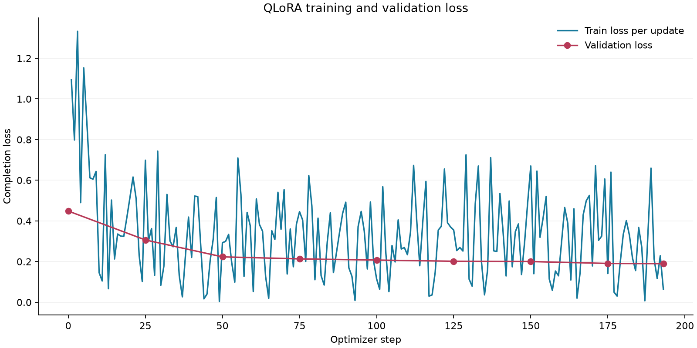
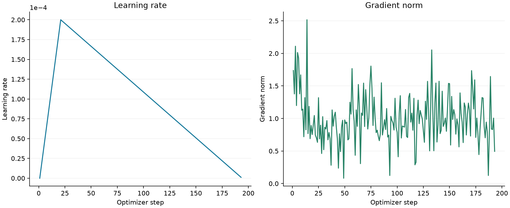
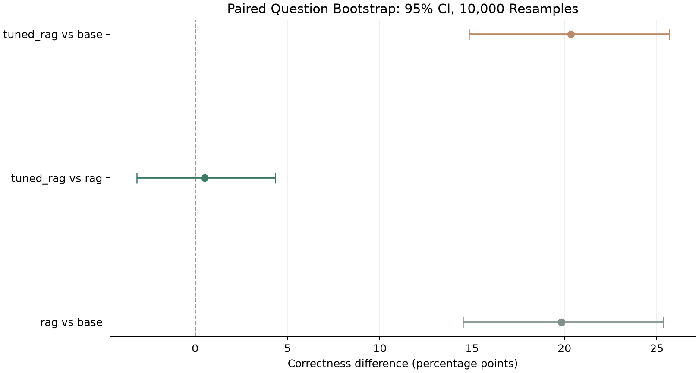

# Báo cáo tuần 07

**Đề tài:** Xây dựng hệ thống quản lý học tập thông minh tích hợp mô hình ngôn ngữ lớn tinh chỉnh và kỹ thuật RAG.
**Thành viên:** Vũ Nam Dương (A, B22DCVT119) và Trần Tuấn Cường (B, B22DCVT073).

## 1. Mục tiêu trong tuần

Mở rộng huấn luyện QLoRA, lựa chọn adapter và so sánh **Base LLM, RAG, Tuned + RAG trên cùng benchmark 300 câu**. Kiểm độc lập dữ liệu, mô hình và kết quả; ghép đánh giá của hai thành viên, phân xử bất đồng và tổng hợp báo cáo.

**Dương:** huấn luyện mở rộng, chạy benchmark và đánh giá phần A. **Cường:** hoàn thiện công cụ, kiểm độc lập, đánh giá phần B và tổng hợp kết quả nhóm.

## 2. Công việc đã thực hiện

### 2.1. Huấn luyện mô hình fine-tune với dữ liệu lớn hơn

Sử dụng bộ 1.000 mẫu đã chuẩn hóa, gồm **770 train / 114 validation / 116 holdout**. Khởi tạo adapter mới từ Qwen2.5-7B-Instruct, huấn luyện **một epoch với 193 bước cập nhật**; giữ riêng holdout, không dùng để huấn luyện hoặc chọn adapter. So với pilot 128/32 trước đó, lượt train này tăng quy mô và độ đa dạng dữ liệu.

| Chỉ số | Kết quả |
| --- | --- |
| Validation loss ban đầu / cuối | 0,44856 / 0,18998; giảm khoảng 57,65% |
| Cập nhật thành công / bị bỏ qua | 193 / 0 |
| Checkpoint được giữ | Bước 150 và 193, cùng final adapter |

Learning rate tăng trong warmup rồi giảm; gradient dao động nhưng không bùng nổ kéo dài. **Mô hình học ổn định, chưa thấy dấu hiệu overfitting tại các mốc validation đã đo**, nhưng giảm loss chưa đủ chứng minh chất lượng trả lời tốt hơn. Adapter được đối chiếu trên cùng tập development trước khi chọn để chạy main.

### 2.2. Chạy benchmark so sánh Base LLM, RAG và Tuned + RAG

Đóng gói adapter, tokenizer, prompt, ngữ cảnh và cấu hình đã khóa; chạy bốn cell của `comparison_main.ipynb` trên Kaggle theo thứ tự: xác thực gói, kiểm môi trường, smoke, chạy main và xuất kết quả. Hai nhánh RAG nhận cùng ngữ cảnh; Base không nhận học liệu.

Benchmark gồm **300 câu thuộc ba môn**, tạo đủ **900 đầu ra: 897 hoàn tất và 3 chạm giới hạn output**. Giữ cả ba trường hợp lỗi trong mẫu số và chấm 0 điểm đúng/đủ, không sinh lại để thay kết quả. Bảng dưới dùng điểm nhóm sau phân xử:

| Chỉ số | Base LLM | RAG | Tuned + RAG |
| --- | --- | --- | --- |
| Điểm đúng/đủ quy đổi | 55,83% | 75,67% | 76,17% |
| Câu đạt điểm tối đa | 118/300 | 193/300 | 191/300 |
| Bám nguồn theo item | N/A | 95,44% | 88,64% |
| Citation precision theo item | N/A | 78,71% | 64,84% |
| Từ chối đúng khi thiếu căn cứ | 47/60 | 58/60 | 59/60 |
| Từ chối rỗng nhầm câu có đáp án | 3/240 | 3/240 | 10/240 |
| Generation trung bình | 5,37 giây | 12,41 giây | 9,73 giây |

Điểm quy đổi là tổng điểm rubric chia điểm tối đa, không phải tỷ lệ câu đúng hoàn toàn. Bám nguồn/citation tính theo item có mệnh đề kiểm chứng được; Base không nhận context nên hai chỉ số này không áp dụng. Thời gian chỉ đo generation, chưa phải độ trễ chatbot end-to-end.

**RAG cải thiện rõ so với Base và giữ lợi thế về bám nguồn, trích dẫn.** Tuned + RAG có định dạng ổn định hơn, nhưng từ chối nhầm nhiều hơn và chưa vượt RAG toàn diện về nội dung.

### 2.3. Hoàn thiện công cụ và kiểm tra độc lập kết quả benchmark

Hoàn thiện bộ công cụ `scripts/comparison/` để kiểm đầu vào, khóa cấu hình, đóng gói và tiếp nhận kết quả. Kiểm checksum gói 609 file; đối chiếu đủ **900 đầu ra**, lịch chạy, prompt/ngữ cảnh và trạng thái bật/tắt LoRA.

Kiểm adapter cuối của lượt train 193 bước với **392 tensor**; tính lại token IDs cho **990 đầu vào dev/main**. Đối chiếu **1.500 liên kết ngữ cảnh và 352 liên kết trang đáp án trên 354 trang thuộc 27 PDF**. Phân chia 770/114/116 và nguồn benchmark được kiểm lại với train/validation; giữ nguyên dữ liệu gốc và ghi rõ giới hạn giao kiến thức.

**Làm rõ giao dữ liệu:** kiểm lại trên đúng **770 train / 114 validation / 116 holdout** cho thấy nguồn main (`CNXHKH:ch03`, `KTCTMLN:ch02`, `THMLN:ch13`) không giao với train/validation và không có câu hỏi main trùng nguyên văn với bộ instruction. Đây là kiểm tách nguồn và trùng câu, **không chứng minh độc lập hoàn toàn về ngữ nghĩa**. Rà soát với 1.175 câu hỏi trước đó vẫn ghi nhận giao khái niệm hoặc một phần đáp án, như câu `Q53025e7a1de1b10dbccf` về vai trò các tổ chức trong phát huy dân chủ và `Qd576db0b25cfb1e00679` về thành phần tồn tại xã hội. Vì vậy, kết quả là so sánh ba phương pháp trong cùng miền kiến thức, không phải phép đo trên 300 khái niệm hoàn toàn mới. Không thay benchmark sau khi xem kết quả.

Việc tách nguồn trên áp dụng cho **nguồn trang đáp án của benchmark main**. Kho truy xuất vẫn dùng chung 27 PDF cho hai nhánh RAG, có thể chứa tài liệu từng dùng để tạo mẫu train; không diễn giải thành toàn bộ context đều độc lập với train.

### 2.4. Đánh giá phần B và đối chiếu kết quả của hai thành viên

Mỗi phần A/B gồm **450 lượt chấm chính + 45 lượt chấm đối chiếu**, dùng cùng rubric, che tên nhánh và khóa điểm trước khi ghép. Toàn bộ có **900 lượt chấm chính + 90 lượt đối chiếu**; không cộng các lượt đối chiếu vào mẫu số chính.

Mức trùng điểm đúng/đủ đạt **90,00%**, Cohen kappa **0,8289**. Có **14 đầu ra bất đồng** về điểm hoặc mức hỗ trợ nguồn/citation đã được phân xử, lưu lý do và quyết định riêng; review gốc vẫn được giữ nguyên. Đây là đánh giá rubric tự động, không phải độ đồng thuận chấm tay của hai người.

### 2.5. Tổng hợp, kiểm thử và bàn giao kết quả

Xuất số liệu theo môn, loại câu hỏi, nhóm lỗi và so sánh theo cặp thành `summary.json`, `metrics.csv`, `paired.json`, `errors.csv`. Gói kết quả nhóm có bốn biểu đồ và báo cáo Markdown/PDF; thư mục minh chứng này lưu ba biểu đồ được chọn từ báo cáo nguồn. Kết quả được kiểm đọc lại và đóng gói kèm manifest, checksum.

Bootstrap **10.000 lần, seed 42**, lấy mẫu theo câu hỏi: Tuned + RAG nhỉnh RAG **0,50 điểm phần trăm**, nhưng khoảng tin cậy 95% **[-3,17; +4,33]** chứa 0, nên chưa đủ cơ sở khẳng định tuning cải thiện độ đúng chắc chắn. Khoảng này chưa bao gồm sai số bộ chấm hoặc biến thiên giữa các lượt train.

Bộ kiểm đã chặn việc mượn module từ `PYTHONPATH` ngoài gói và chấm điểm khác 0 cho câu có đáp án nhưng trả JSON rỗng. **159/159 test comparison hiện tại đạt**; xem [kết quả kiểm thử](test-results.txt).

**Đối chiếu định tính bổ sung:** chọn có chủ đích **6 câu × 3 nhánh = 18 đầu ra**, phủ ba môn, để xem các trường hợp cải thiện, thoái lui và lỗi truy xuất. Đã đối chiếu câu hỏi, đầu ra, ngữ cảnh thực nhận và trang đáp án; kiểm nguồn của mẫu trên **10 PDF / 28 trang vật lý**. Điểm trong bảng là điểm nhóm đã khóa, không phải lượt chấm mới.

| Câu hỏi | Lỗi hoặc khác biệt tiêu biểu | Điểm Base / RAG / Tuned |
| --- | --- | --- |
| `Q4344aa57122e22b72c9b` | RAG dẫn đúng một đoạn nhưng nêu biểu hiện tâm lý giai cấp, không trả lời về hoàn cảnh sinh hoạt cá nhân. Tuned trả lời đúng trọng tâm. | 2 / 0 / 2 |
| `Qccfbf233ff6538caa5f0` | RAG nhầm thanh toán phải dùng tiền đủ giá trị. Tuned phân biệt đúng mua bán/trả nợ, nhưng chỉ dẫn E4.1 ở trang 15; ý thanh toán cần E1.1 ở trang 16. Nội dung đúng chưa đồng nghĩa citation đủ. | 0 / 0 / 2 |
| `Q282e378db6c96ffa15d0` | Đã có công thức `M = PQ/V`, nhưng Tuned kết luận M tăng gấp đôi khi PQ và V cùng tăng hai lần; đúng ra M không đổi. Đây là lỗi suy luận, không phải thiếu công thức trong context. | 2 / 2 / 0 |
| `Qecae530a48d3c852bc41` | Base hiểu nhầm sang trao đổi chất sinh học. Tuned chép ý về tiêu dùng, không giải thích cái chung là lao động xã hội, đồng thời dẫn khác đoạn hỗ trợ. | 0 / 2 / 0 |
| `Qab46ace5f85b17c741c6` | Tuned trả rỗng; cache không có trang gold CNXHKH chương 3, trang 12. Cần xem lỗi truy xuất trước, không quy trường hợp này chỉ cho hành vi từ chối của adapter. | 1 / 0 / 0 |
| `Q7a7d654f503db86baaa9` | Tuned lặp lại câu hỏi; RAG trả lời một phần nhưng thiếu ý kế thừa thành tựu. Cache có 2/3 trang gold, thiếu trang 16: có cả hạn chế tổng hợp và thiếu ngữ cảnh. | 1 / 1 / 0 |

**Đã hoàn thành đối chiếu định tính 18 đầu ra với câu hỏi, ngữ cảnh và trang đáp án**, lưu nhận xét theo từng ID. Mẫu này phục vụ phân tích lỗi, không dùng để ước lượng tỷ lệ lỗi toàn bộ benchmark và không phải một lượt chấm tay độc lập. Đầu ra, nguồn, điểm nhóm và các gói đã khóa được giữ nguyên; phạm vi kiểm tra và thông tin đối chiếu nằm trong [manifest.json](manifest.json).

## 3. Quản lý mã nguồn và bằng chứng

| Thành phần | Tham chiếu |
| --- | --- |
| Repository / PR | [smart-lms-rag](https://github.com/CuongTT-04/smart-lms-rag), [PR #18 của Dương](https://github.com/CuongTT-04/smart-lms-rag/pull/18), [PR #17 của Cường](https://github.com/CuongTT-04/smart-lms-rag/pull/17) |
| Commit tiêu biểu | `4f7a27e`: huấn luyện mở rộng, chạy và đánh giá ba nhánh; `c25d9ab`: kiểm độc lập, chấm phần B và tổng hợp; `a99fd6c`: sửa kiểm điểm câu trả lời rỗng |
| Milestone | So sánh Base LLM vs RAG vs tuned+RAG trên cùng benchmark |
| Kết quả kiểm tra | **159 test đạt**; [log kiểm thử](test-results.txt) |
| Chỉ số và toàn vẹn | [metrics.csv](metrics.csv), [manifest.json](manifest.json); ba biểu đồ gốc trong `figures/` |
| Báo cáo nguồn | [Báo cáo tiến độ tuần 07](https://docs.google.com/document/d/1PDohFub9IxAexOdSCmmqq7aPRwZNejCz/edit) |

## 4. Tổng kết và hướng tiếp theo

Nhóm đã huấn luyện mở rộng, chạy đủ 900 đầu ra, kiểm độc lập và hoàn tất đánh giá nhóm sau phân xử. **RAG cải thiện rõ chất lượng so với Base; Tuned + RAG có lợi về định dạng nhưng chưa chứng minh vượt RAG về độ đúng và còn hạn chế về citation, từ chối nhầm.**

- Hoàn thiện Evaluation report v1, tổng hợp cấu hình, checkpoint và nguồn gốc adapter đã chọn.
- Công bố snapshot benchmark 300 câu kèm căn cứ tách nguồn khỏi train/validation và giới hạn giao kiến thức; giữ nguyên bộ đã đánh giá.
- Phân tích lỗi, cải thiện truy xuất nhiều trang, citation và hành vi từ chối trên dữ liệu phát triển; tỷ lệ truy đủ trang gold ở câu nhiều trang hiện là 30,00%.
- Đánh giá bổ sung trên **116 instruction holdout** để kiểm khả năng tổng quát hóa, không dùng tập này để điều chỉnh kết quả benchmark hiện tại.
