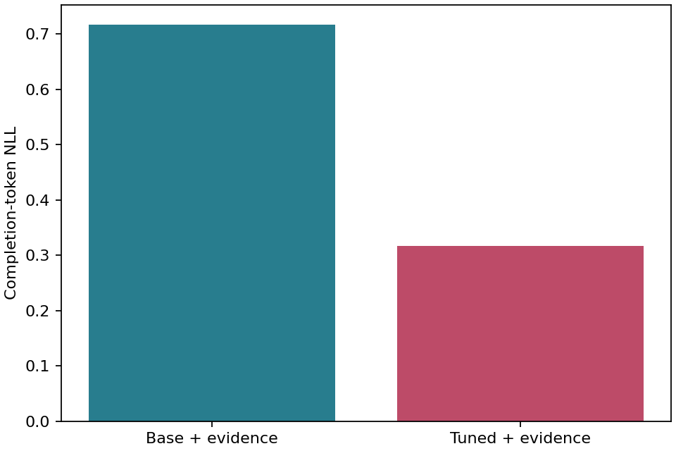
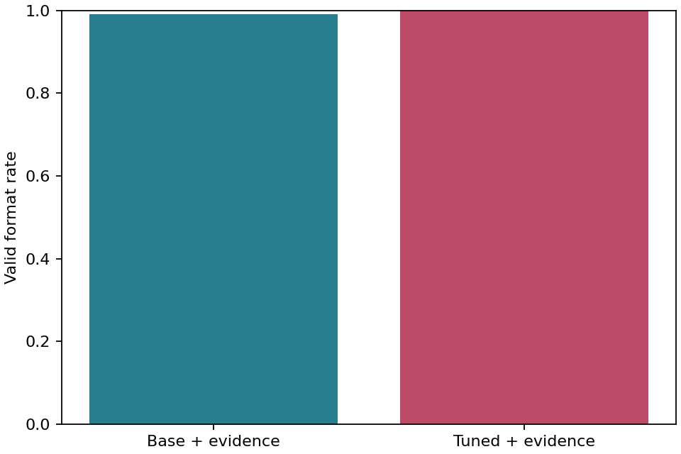
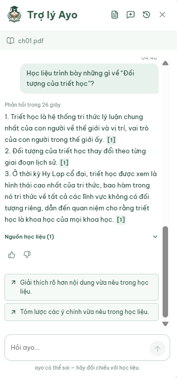
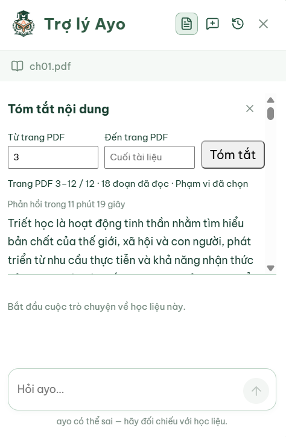
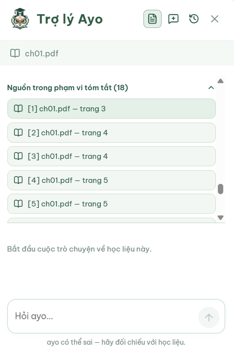
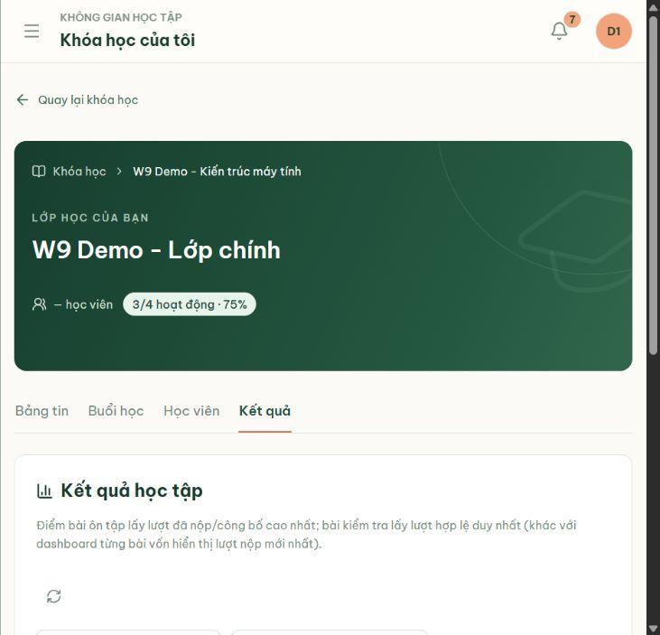
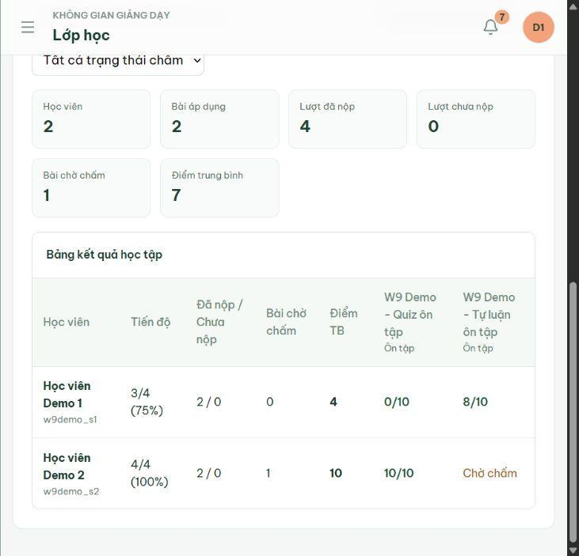
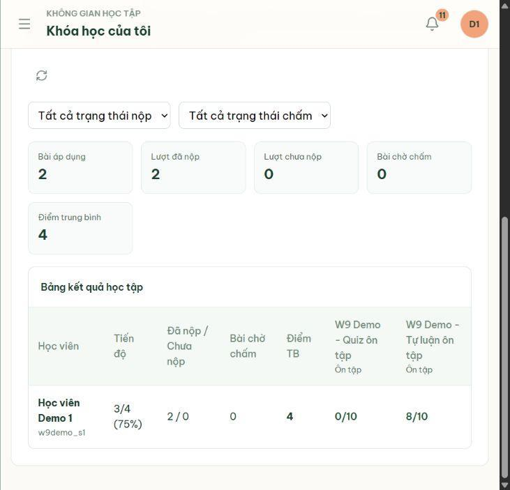
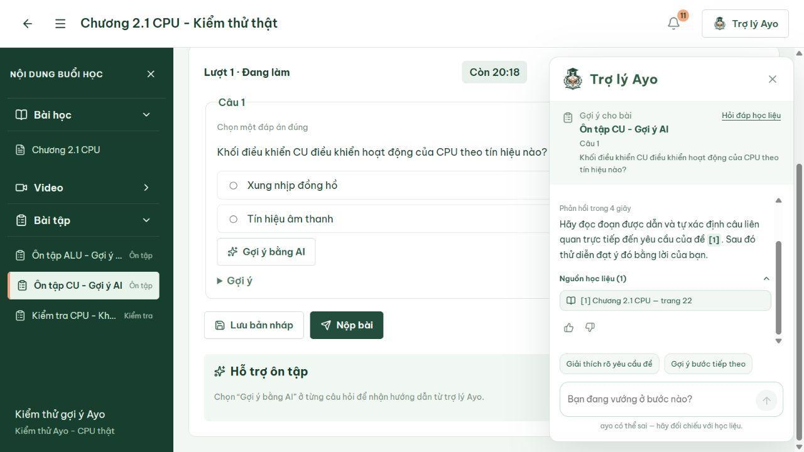
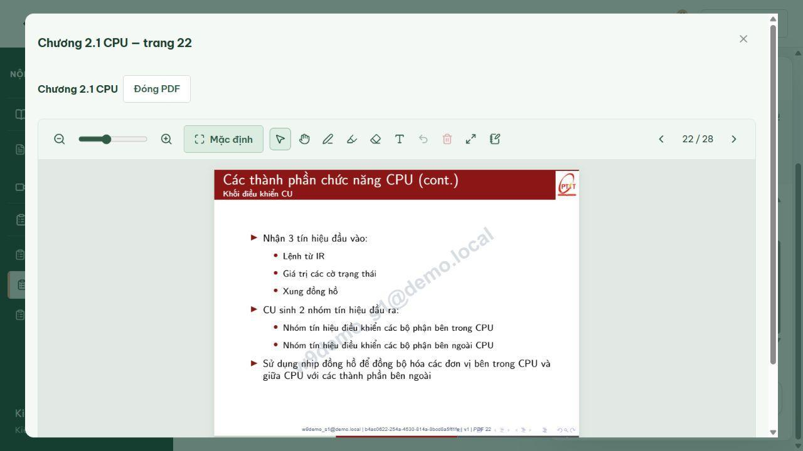

# Báo cáo tiến độ tuần 08

## 1. Mục tiêu trong tuần

Hoàn thiện LMS core **course/lesson/quiz/submission + AI assistant**: đánh giá mô hình trên dữ liệu holdout, bổ sung chức năng Ayo, theo dõi tiến độ học tập và tích hợp luồng làm, nộp, chấm, công bố kết quả.

**Dương:** đánh giá mô hình gốc và fine-tune trên 116 mẫu holdout; bổ sung tóm tắt học liệu và câu hỏi tiếp theo. **Cường:** tiến độ học tập, bảng kết quả lớp, luồng bài nộp và tích hợp LMS với Ayo.

## 2. Công việc đã thực hiện

### 2.1. Đánh giá mô hình gốc và fine-tune trên cùng tập holdout

Giữ riêng **116 mẫu không tham gia huấn luyện** để so sánh mô hình gốc và adapter đã chốt. Hai mô hình nhận cùng nguồn được cấp sẵn; đây **không phải phép đánh giá toàn bộ luồng truy xuất RAG** và không huấn luyện thêm trên holdout.

| Chỉ số | Mô hình gốc + nguồn | Fine-tune + nguồn |
| --- | --- | --- |
| Hoàn tất generation | 116/116 | 116/116 |
| Loss trên token đáp án | 0,7173 | 0,3168 |
| Đúng định dạng | 115/116 | 116/116 |
| Citation ID hợp lệ trên mẫu có thể trả lời | 105/106 | 106/106 |
| Khớp chính xác đáp án/hành động chuẩn | 24/116 | 45/116 |
| Hint chọn đúng hành động chuẩn | 9/10 | 10/10 |
| Từ chối đúng khi thiếu căn cứ | 10/10 | 10/10 |
| Thời gian sinh trung bình/mẫu | 4,67 giây | 6,11 giây |

Loss giảm khoảng **55,83%**, cho thấy fine-tune phù hợp hơn với đáp án chuẩn trên tập chưa dùng để học. Đây không phải mức tăng độ chính xác 55,83%.

Đúng định dạng tăng từ **99,14% lên 100%**. Fine-tune cải thiện mức khớp đáp án và hành động chuẩn, nhưng sinh chậm hơn; định dạng và Citation ID hợp lệ chưa chứng minh mọi nội dung đều đúng hoặc được nguồn hỗ trợ đầy đủ.

### 2.2. Xây dựng các chức năng mới cho chatbot

**a. Gợi ý câu hỏi tiếp theo**

Sau câu trả lời, Ayo hiển thị tối đa ba gợi ý theo mẫu bám câu hỏi và học liệu hiện tại. Nhấn một gợi ý mới gửi câu hỏi tiếp trong cùng hội thoại; chỉ hiển thị gợi ý không phát sinh lượt gọi mô hình.

Gợi ý “Tóm lược các ý chính vừa nêu” chỉ nối tiếp nội dung đang trao đổi, không tự tóm tắt toàn bộ tài liệu.

**b. Tóm tắt nội dung học liệu**

Người học chọn phạm vi trang PDF; để trống trang kết thúc nghĩa là đọc đến cuối tài liệu. Hệ thống xử lý toàn bộ các đoạn nguồn trong phạm vi hợp lệ theo từng lô, hiển thị tiến độ và công bố bản tóm tắt khi hoàn tất, không chỉ lấy top-k như hỏi đáp.

Ví dụ `ch01.pdf` được tóm tắt từ trang **3–12/12**, gồm **18 đoạn nguồn**, không phải 18 trang. Danh sách nguồn cho phép mở đúng trang để đối chiếu; nhiều đoạn có thể cùng thuộc một trang.

Bản tóm tắt vẫn có thể lặp ý, thiếu chi tiết hoặc diễn đạt chưa sát nguồn, không thay thế tài liệu gốc. Chatbot trên web hiện dùng **Qwen gốc + RAG**, chưa bật adapter fine-tune; dự kiến so sánh hai cấu hình sau khi các chức năng ổn định.

### 2.3. Bổ sung tiến độ học tập theo hoạt động của lớp

Tiến độ bằng số hoạt động hoàn thành chia tổng hoạt động đang công bố; PDF, video và bài đánh giá có trọng số bằng nhau, không tính nội dung nháp hoặc đã gỡ.

- **PDF:** người học xác nhận “Đã học”; công bố phiên bản mới yêu cầu xác nhận lại.
- **Video:** áp dụng điều kiện xem và checkpoint hiện có.
- **Bài đánh giá:** lượt nộp hợp lệ được tính hoàn thành kể cả khi đang chờ chấm; tiến độ tách biệt với điểm số.

Trong demo bốn hoạt động, S1 hoàn thành **3/4 = 75%**; trạng thái được giữ sau tải lại trang và khởi động lại backend. Tiến độ được tính lại khi nội dung công bố thay đổi; thao tác gửi lặp không làm tăng tiến độ.

### 2.4. Hoàn thiện bảng kết quả lớp và luồng làm, nộp bài

Giáo viên xem tiến độ, tình trạng nộp và điểm trên bảng “Kết quả”, lọc bài chờ chấm và xuất Excel. Hệ thống phân biệt chưa nộp, chờ chấm và đã có điểm, kể cả điểm 0; học viên chỉ thấy kết quả cá nhân và điểm đã công bố.

Bài ôn tập lấy điểm cao nhất trong các lượt nộp hợp lệ được phép truy cập; bài kiểm tra lấy lượt hợp lệ duy nhất. Demo cho thấy S1 đạt **75%**, quiz **0/10**, tự luận **8/10**; S2 đạt **100%**, tự luận đang chờ chấm. Kết quả của S1 vẫn được giữ sau đăng nhập lại và restart backend.

Đồng thời kiểm luồng lưu nháp, nộp, chấm, công bố điểm; sửa thống kê đáp án rỗng và nối trợ giúp trong bài ôn tập với Ayo. Trợ giúp AI được ẩn trong chế độ kiểm tra.

### 2.5. Tích hợp LMS với Ayo và kiểm tra hoạt động của hệ thống

Ghép chức năng đánh dấu PDF đã học, cập nhật tiến độ và gợi ý ôn tập theo đúng bài/câu hỏi với các luồng hỏi đáp, lịch sử, tóm tắt và quyền học liệu.

Lượt kiểm tích hợp riêng của Cường sử dụng tài liệu CPU: **8 câu có căn cứ và 2 câu thiếu căn cứ**; kiểm thêm hỏi tiếp, hội thoại độc lập và gửi lặp cùng `client_message_id`. Tóm tắt được kiểm trên **trang 7–9/28**, chỉ xác nhận phạm vi ba trang này, không phải toàn tài liệu.

Sửa truy xuất gợi ý bằng cách bổ sung tiêu đề và đề bài công khai, không đưa đáp án hoặc rubric riêng vào context. Kiểm lại hai lượt dẫn đúng nội dung ALU trang 23; ảnh minh họa câu hỏi CU dẫn trang 22. API chặn AI khi bài kiểm tra còn hiệu lực và cho phép trở lại sau khi bài được gỡ.

| Phạm vi kiểm thử | Kết quả và mốc kiểm chứng |
| --- | --- |
| Backend chính, kiểm lại ngày 21/11 | 433/433 test đạt |
| Runtime/xử lý tài liệu, cấu hình riêng | 84 test đạt trong lượt kiểm ngày 20/11 |
| Upload/worker, cấu hình riêng | 27 test đạt trong lượt kiểm ngày 20/11 |
| Frontend, kiểm lại ngày 21/11 | 374/374 test thuộc 56 tệp đạt |
| Gợi ý ôn tập theo từng bước, kiểm với Qwen thật ngày 21/11 | 8/8 lượt thành công trên ALU và CU; nguồn trang 23 và 22 |
| Lint và build, kiểm lại ngày 21/11 | Hoàn tất; build còn cảnh báo kích thước gói JavaScript |

Log và phạm vi từng lượt kiểm được ghi trong [test-results.txt](test-results.txt). Các lượt kiểm có phạm vi hoặc ngày chạy khác nhau được ghi riêng; không cộng thành tổng số test của cùng một lần chạy.

## 3. Quản lý mã nguồn và bằng chứng

| Thành phần | Tham chiếu |
| --- | --- |
| Repository / PR | [smart-lms-rag](https://github.com/CuongTT-04/smart-lms-rag), [PR #19 của Dương](https://github.com/CuongTT-04/smart-lms-rag/pull/19), [PR #20 của Cường](https://github.com/CuongTT-04/smart-lms-rag/pull/20) |
| Commit tiêu biểu | `77f9259`: holdout và hai chức năng Ayo; `818a9c3`, `1163002`: LMS và tích hợp; `40e9789`: sửa gợi ý theo đề ôn tập |
| Milestone | Hoàn thiện LMS core: course/lesson/quiz/submission + AI assistant |
| Minh chứng hình ảnh | Hai biểu đồ holdout và tám ảnh giao diện trong [figures/](figures/) |
| Báo cáo nguồn | [Báo cáo tiến độ tuần 08](https://docs.google.com/document/d/1uBBA36607MtSGyxczjKc4M-hfMWRT_1w/edit) |

## 4. Tổng kết và hướng tiếp theo

Đã đánh giá hai mô hình trên holdout, bổ sung tóm tắt và câu hỏi tiếp theo, lưu tiến độ theo hoạt động/phiên bản, hoàn thiện bảng kết quả và tích hợp luồng bài nộp với Ayo. **Fine-tune cải thiện loss và định dạng trong phép kiểm có sẵn nguồn; chatbot web vẫn dùng mô hình gốc + RAG.**

- Kiểm guardrails với câu thiếu căn cứ, yêu cầu lộ đáp án, prompt injection và citation sai.
- Siết quyền PDF/API khi gỡ học liệu, đổi phiên bản hoặc thu hồi ghi danh; bảo vệ rubric và điểm chưa công bố.
- Kiểm citation đúng tài liệu, trang và nội dung hỗ trợ; giảm gợi ý lặp ý.
- Hoàn thiện minh chứng, kiểm giao diện Ayo trên bản tích hợp và đánh giá cấu hình fine-tune + RAG khi sẵn sàng.
