# Báo cáo tiến độ tuần 09

## 1. Mục tiêu trong tuần

Hoàn thiện **guardrails, quyền truy cập tài liệu, chống lộ nội dung/citation sai** cho trợ lý Ayo trong OHAYO; đồng thời bổ sung nền xác minh email, bảo mật phiên và các chức năng quản trị.

**Dương:** so sánh hành vi base LLM và mô hình fine-tune khi áp dụng guardrails, tích hợp mô hình và xây dựng chức năng Admin. **Cường:** kiểm quyền học liệu, bộ dữ liệu thử dùng chung, xác minh email, bảo mật phiên và kiểm thử sau ghép.

## 2. Công việc đã thực hiện

### 2.1. So sánh hành vi mô hình khi áp dụng guardrails

Hai cấu hình nhận cùng **14 yêu cầu mỗi nhánh** gồm hỏi đáp, tóm tắt và gợi ý, sử dụng ngữ cảnh cố định. Mỗi nhánh có **12 phản hồi hợp lệ và hai yêu cầu bị chặn đúng chính sách**; kết quả đối chiếu tự động đạt 14/14 trường hợp mỗi nhánh. Đây là phép kiểm hành vi khi đã được cấp nguồn, tách với ma trận truy xuất và kiểm quyền bên dưới.

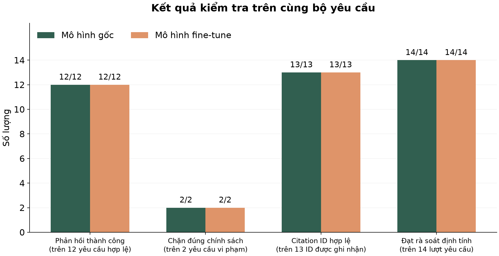

Trung vị thời gian xử lý của mô hình gốc và fine-tune lần lượt là **3,41 và 4,93 giây**; P95 là **40,12 và 44,10 giây**. Số đo gồm lượt khởi động và lượt bị chặn sớm, chỉ mô tả lần chạy này.

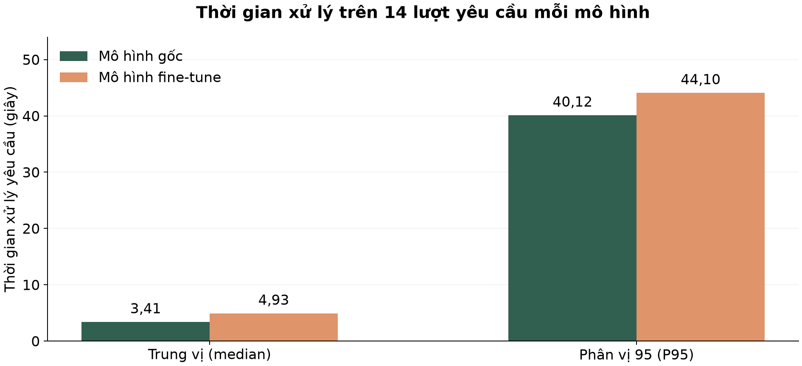

### 2.2. Phát triển các chức năng quản trị

Admin đã có năm nhóm chức năng: **Tổng quan, Tài khoản, Duyệt giáo viên, Danh mục trường và Vận hành**. Các thao tác nối với API; xét duyệt giáo viên tách biệt với xác minh email, nhập danh mục phải xem trước và kiểm lỗi trước khi xác nhận.

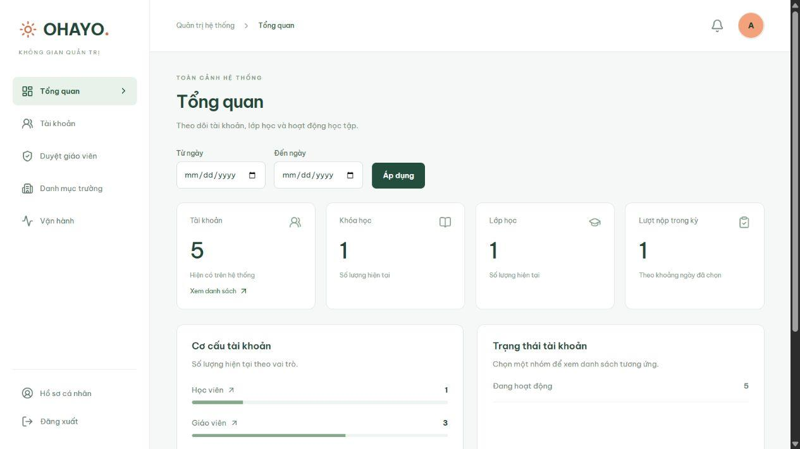
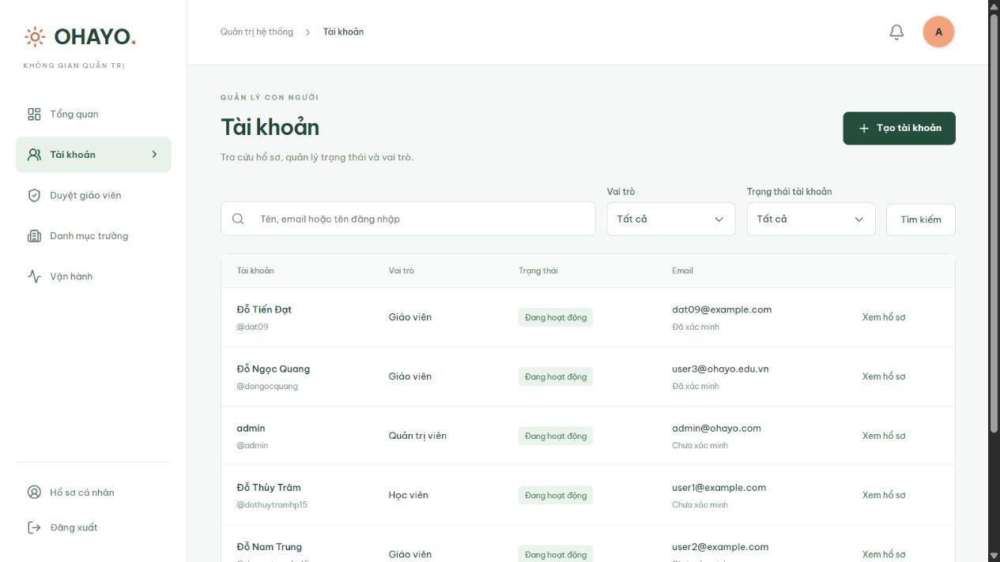
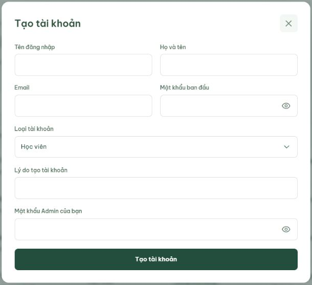
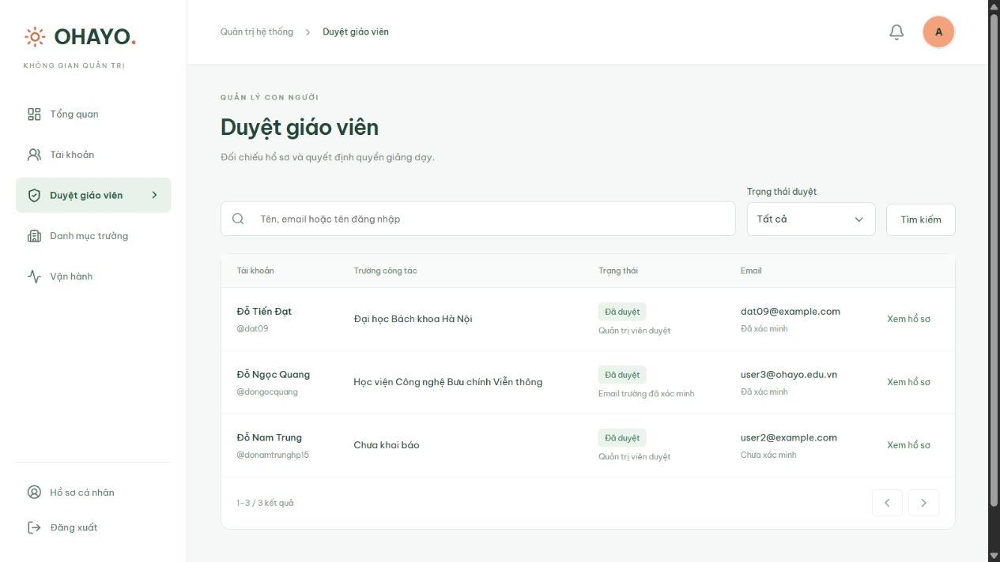
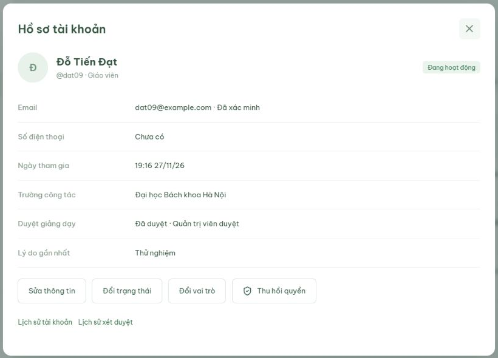
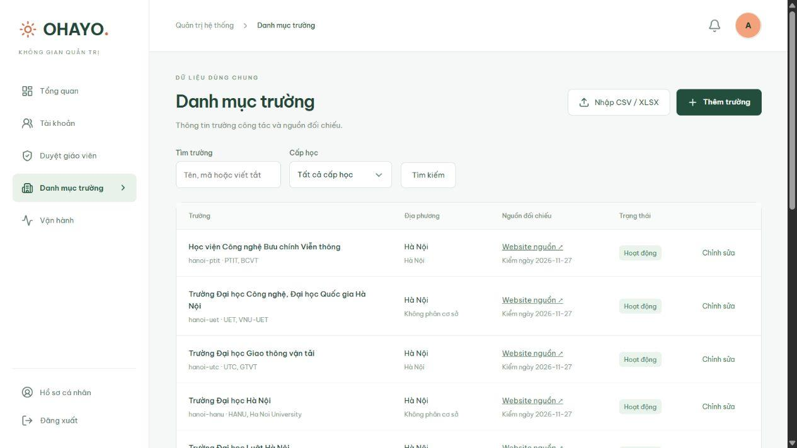
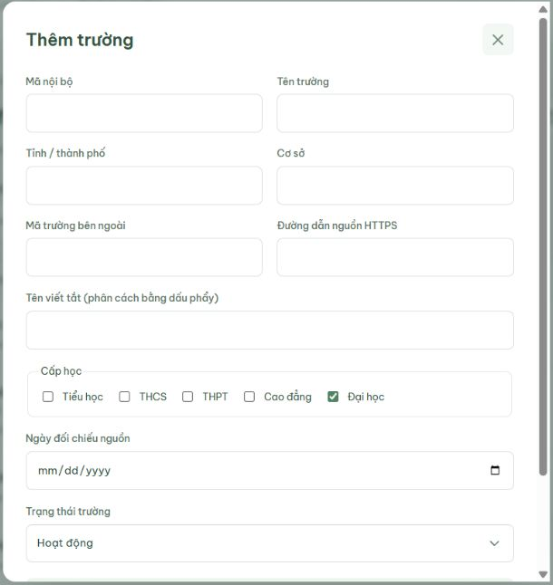
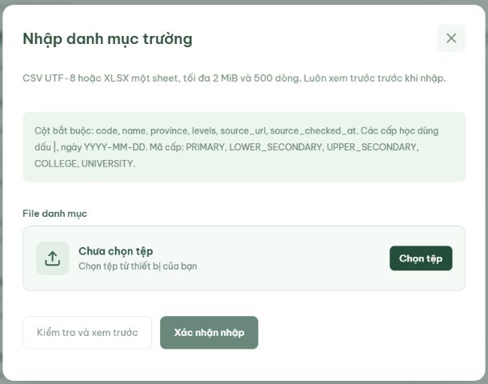
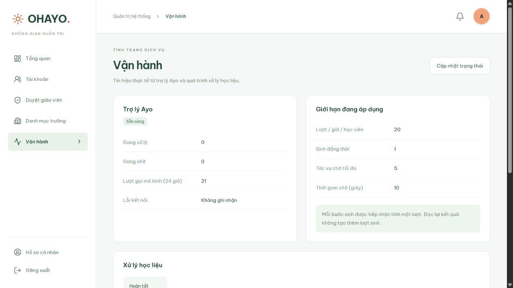

### 2.3. Kiểm quyền học liệu và thu hồi quyền

Backend kiểm phạm vi khóa học, lớp, tài liệu và phiên bản tại các đường đọc, trước/sau xử lý AI và khi mở nguồn. **17 tình huống từ chối trong ma trận không ghi nhận lộ dữ liệu trái quyền.** Bộ dữ liệu dùng chung bao gồm tài khoản nhiều vai trò, khác lớp/khóa và học liệu nháp, bị gỡ, thay phiên bản.

Kiểm tra giao diện riêng đã ghi nhận: học viên mở được PDF khi còn công bố, giáo viên thu hồi, học viên mở lại cùng học liệu thì bị chặn. Các ảnh sử dụng tài khoản và PDF thử trong cơ sở dữ liệu riêng; luồng mở lại citation từ câu trả lời Ayo còn cần kiểm chứng riêng.

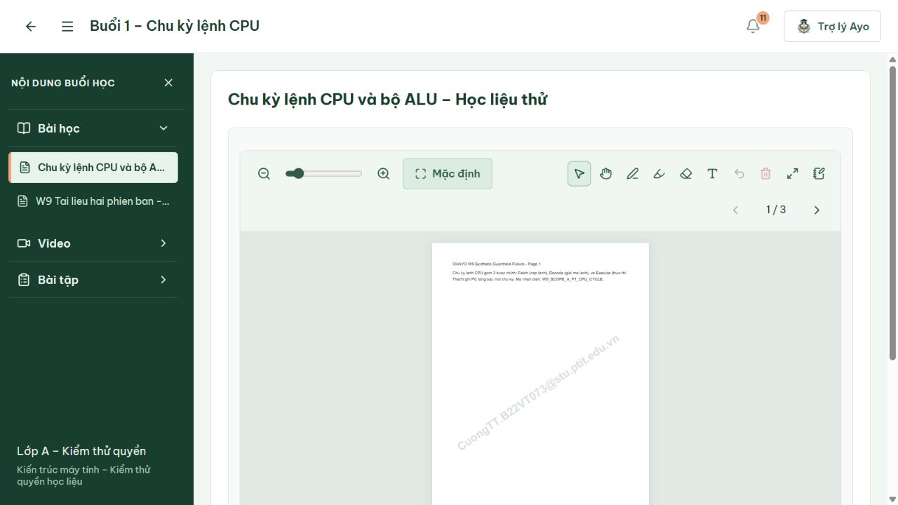
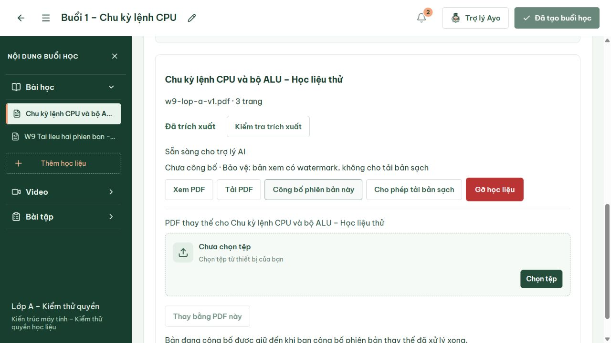
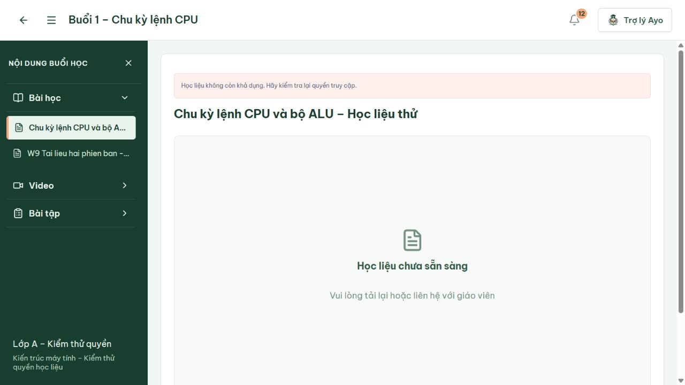

### 2.4. Xác minh email và bảo mật phiên

Đã bổ sung mã xác minh băm, dùng một lần, hạn 24 giờ; thu hồi phiên theo trạng thái tài khoản; kiểm CSRF và giới hạn đăng nhập. Lượt thử SMTP Gmail ngày **28/11/2026** đã gửi thư tới hộp thư sinh viên PTIT, người nhận mở liên kết và xác minh thành công. Lượt gửi dùng cấu hình SMTP riêng và cơ sở dữ liệu thử; backend đang vận hành vẫn dùng cấu hình console.

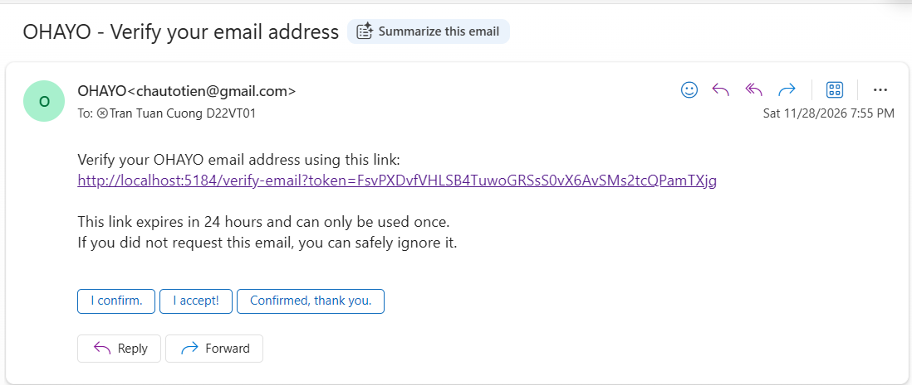
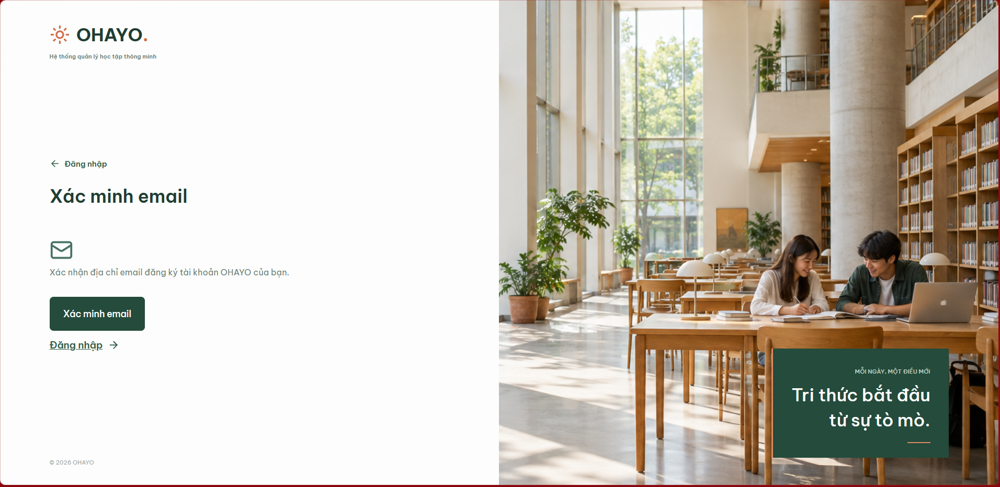
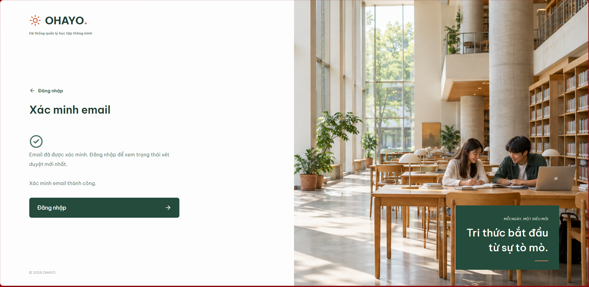
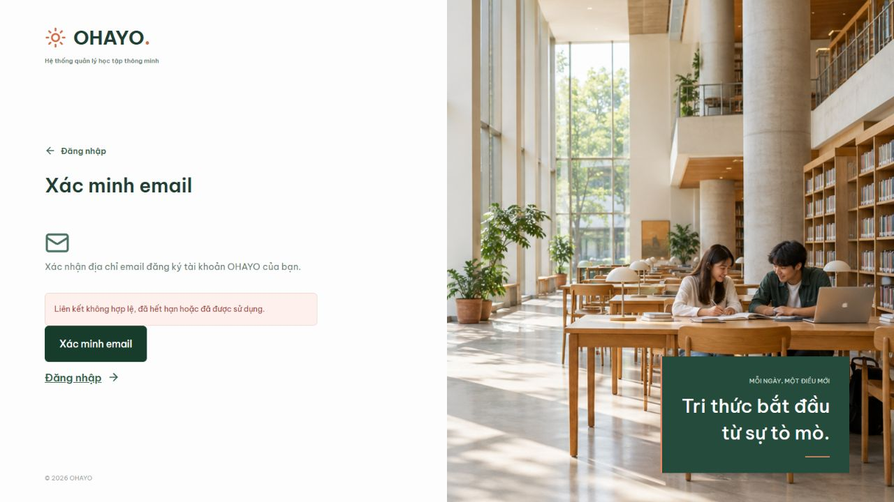

### 2.5. Tích hợp và kiểm thử sau ghép

Sau PR #27, nhóm sửa việc giữ đúng lỗi 401/403 sau suy luận, đồng bộ giao thức citation có cấu trúc cho hỏi đáp không lưu hội thoại, thứ tự trang và ghi nhận trạng thái vận hành. Cường bổ sung điều chỉnh bố cục, ô chọn và chuyển tab Admin, sau đó tổng hợp bằng chứng.

| Phạm vi | Kết quả |
| --- | --- |
| Ma trận guardrails sau sửa | 36/36 đạt; kết hợp API thực và trạng thái chủ động tạo tại các ranh giới xử lý |
| Backend chính | 1.055/1.060 đạt; năm ca bỏ qua do phụ thuộc tùy chọn |
| Frontend | 413/413 đạt trên 61 tệp; lint/build thành công |
| Upload/worker và công cụ so sánh | Lần lượt 27/27 và 28/28, kiểm riêng |
| Nguồn trong bốn câu hỏi có căn cứ của fixture | 17/17 nhận định được hỗ trợ, bao phủ 17/17 ý; hai câu thiếu căn cứ xử lý đúng |
| Đối chứng với học liệu Mạng máy tính mới | 12/12 citation đúng trang; 31/35 nhận định đạt về nội dung trên nguồn không dấu |

Kết quả đối chiếu nội dung tự động còn chờ thành viên kiểm chéo. Tóm tắt chưa có chỉ số citation theo từng nhận định; build còn cảnh báo kích thước gói. Chi tiết phạm vi và lệnh chạy lại nằm trong [test-results.txt](test-results.txt); không cộng các lượt kiểm riêng thành một tổng.

## 3. Quản lý mã nguồn và bằng chứng

| Thành phần | Tham chiếu |
| --- | --- |
| Repository / PR | [smart-lms-rag](https://github.com/CuongTT-04/smart-lms-rag/pull/28), [PR #27](https://github.com/CuongTT-04/smart-lms-rag/pull/27) |
| Commit của Dương | `8197d2d`: guardrails và mô hình; `f04c7df`: sửa quyền và giám sát vận hành |
| Commit của Cường | `7df6e6a`: quyền học liệu; `cf30f39`: email/phiên/CSRF |
| Minh chứng | 18 ảnh giao diện và biểu đồ từ báo cáo trong [figures/](figures/); số liệu trong [metrics.csv](metrics.csv); dấu kiểm toàn vẹn trong [manifest.json](manifest.json) |
| Báo cáo nguồn | [Báo cáo tiến độ tuần 09](https://docs.google.com/document/d/1IdbA9T8Y5_o9T7AMJmaGvnJ817NEuZlg/edit) |

## 4. Tổng kết và hướng tiếp theo

Đã bổ sung guardrails, kiểm quyền học liệu, xác minh email và nền quản trị; ma trận sau sửa đạt 36/36 tình huống đã chọn. Nhóm tiếp tục:

- Kiểm chéo kết quả đối chiếu nội dung và hoàn tất bàn giao phần sửa sau ghép.
- Kiểm và chụp luồng mở lại citation của Ayo sau khi thu hồi quyền.
- Áp dụng và kiểm cấu hình SMTP thật trên backend vận hành.
- Bổ sung tình huống khác bộ đã thử và kiểm các thao tác quản trị trực tiếp trên trình duyệt.
