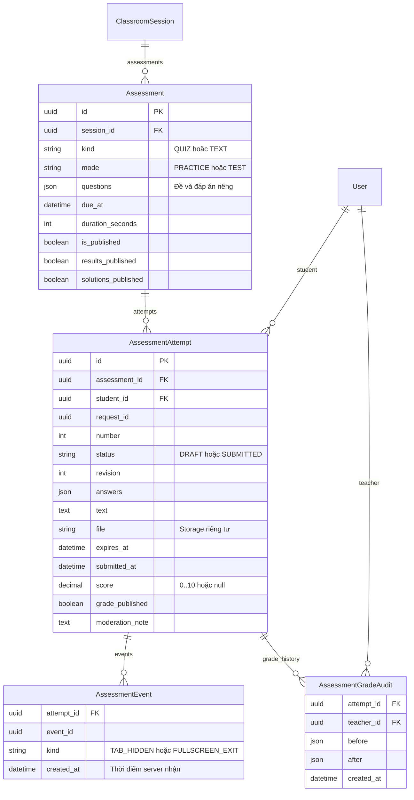

# Bài tập, lượt làm và chấm bài

Cập nhật 17/10/2026; triển khai bằng `courses.0014_assessments`.

- Đề đóng băng từ lượt làm đầu tiên; đổi đề cần bài mới. Các câu quiz nằm trong JSON có mã ổn định; đáp án không trả trong đề học viên.
- Unique `(assessment, student, request_id)` và `(assessment, student, number)`; mỗi học viên chỉ một DRAFT đang hoạt động trong một bài. TEST chỉ một lượt toàn bộ; PRACTICE tạo lượt kế tiếp sau khi nộp, sao chép nội dung tự luận/tệp nhưng không sao chép điểm.
- Mọi chuyển trạng thái khóa hàng Assessment trong giao dịch. Revision cũ bị từ chối 409. Nộp lặp trả lại lượt đã nộp; quiz quá giờ chốt từ dữ liệu đã lưu ở lần API tiếp theo.
- Sự kiện chỉ ghi ở TEST, unique `(attempt, event_id)`. Không có trigger thay điểm/nộp bài do vi phạm. Giáo viên ghi quyết định và điểm; mọi thay đổi được lưu before/after cùng người chấm.
- Tệp thay khỏi bản nháp được dọn sau commit nếu không có lượt nào tham chiếu. Tệp dùng trong lượt đã nộp được giữ khi tạo bản sửa Ôn tập mới.
- Dashboard tính theo lượt đã nộp mới nhất/học viên; lịch sử và XLSX chứa mọi lượt trong bộ lọc. Người đã rời lớp có nhãn riêng cho giáo viên; học viên mất quyền không đọc được bài/điểm/tệp qua lớp.

Cập nhật kiểu trắc nghiệm 17/10/2026: giáo viên chọn **Một đáp án / Nhiều đáp án** riêng cho từng câu trong video và quiz. Thuộc tính `multiple` là cấu hình tường minh, không suy ra từ số đáp án đúng. Một đáp án dùng radio tròn, cần đúng một đáp án đúng; Nhiều đáp án dùng checkbox vuông, cho cấu hình từ một đáp án đúng trở lên. Chấm theo tập lựa chọn khớp toàn bộ đáp án, không cho điểm một phần. Dashboard/Excel dùng cùng quy tắc và hiển thị đầy đủ các lựa chọn đã chọn.
