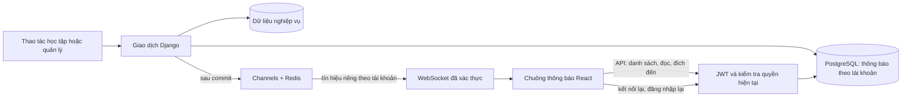

# Kiến trúc thông báo realtime

- Đăng xuất không xóa inbox. Người offline nhận bản ghi trong PostgreSQL giống người online.
- Socket dùng vé ngắn hạn, một lần; chỉ đẩy tín hiệu để trình duyệt tải dữ liệu qua API xác thực.
- Unique `(event_id, recipient)` chống ghi trùng; chuyển trạng thái nghiệp vụ và no-op được phân biệt trước khi phát sự kiện.
- Mất Redis vẫn lưu DB. Kết nối lại/focus/định kỳ 30 giây sẽ tải bù; không bảo đảm mỗi gói WebSocket được giao hoặc phát lại toast.
- Redis không mở cổng host. Nginx chuyển tiếp `/ws/`; Daphne phục vụ HTTP và WebSocket.
- Không dùng RabbitMQ; không thêm worker thông báo hoặc bảo đảm phát lại bằng transactional outbox trong đợt này.

Chi tiết hợp đồng, phạm vi và giới hạn: [Thông báo](../notifications.md).
